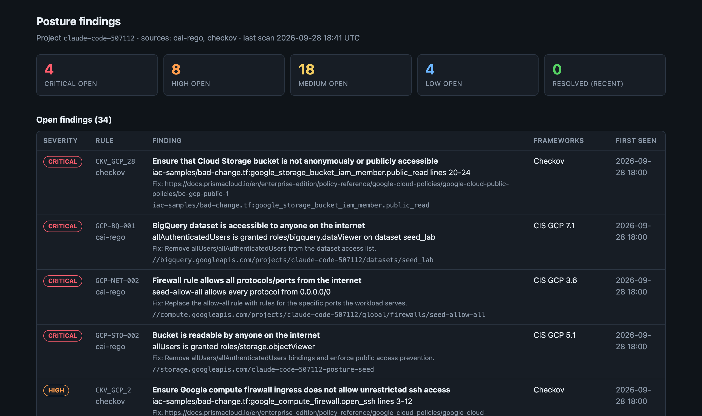
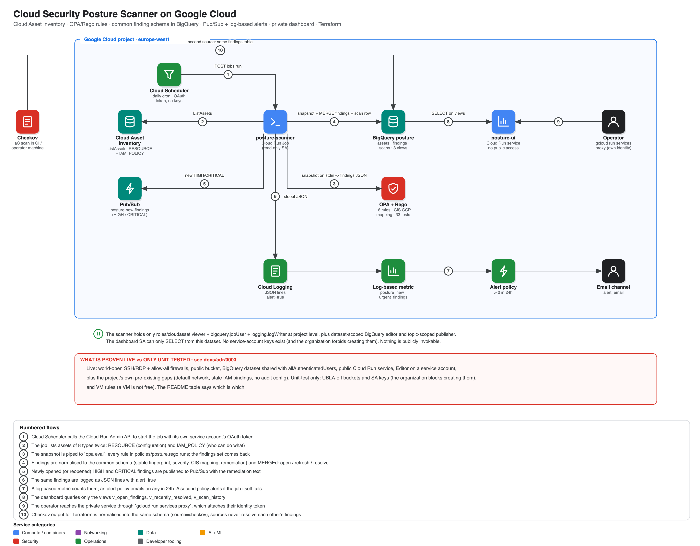

# Cloud Security Posture Scanner on Google Cloud

A scanner for the configuration of a GCP project, built the way a security team would want to run it: the **rules are code** (Rego, unit-tested, mapped to CIS GCP controls), every finding has a **stable identity and a lifecycle** (open → resolved → reopened, with `first_seen` preserved), and **two independent sources** — the live cloud (Cloud Asset Inventory) and infrastructure code (Checkov) — land in **one schema in BigQuery**. New HIGH/CRITICAL findings alert by email and Pub/Sub. A private dashboard shows the current state. Provisioned and destroyed by **one script each**.

> **Status: deployed and verified live** (project `claude-code-507112`, europe-west1, 2026-09-28). `./scripts/test.sh`: **45 passed, 0 failed** — see [docs/test-results.md](docs/test-results.md), which also lists the seven real defects the first live runs exposed. Rego: 33 unit tests. Python: 14 unit tests (one runs the real `opa` binary against a real inventory capture).

```bash
gcloud config set project <your-project>     # billing linked; the rest is auto-detected
./scripts/up.sh       # infra -> image -> scan -> Checkov ingest -> live tests -> lifecycle drill
./scripts/dashboard.sh                       # http://localhost:8088 (private, your own identity)
./scripts/down.sh     # delete everything, including the deliberately-misconfigured lab
```



<sub>Captured from the deployed dashboard. Full page: [docs/img/dashboard.png](docs/img/dashboard.png). The rows include the lab's seeded misconfigurations, the project's own pre-existing gaps, and Checkov findings for an un-deployed "pull request" sample.</sub>

## What it proves

| Claim | Mechanism | Proven by |
|---|---|---|
| Real misconfigurations are found | 16 Rego rules over 8 resource types + 4 IAM-policy types | test §4: world-open firewalls, public bucket, BigQuery dataset shared with `allAuthenticatedUsers`, public Cloud Run service, Editor on a service account — all created by Terraform, all caught with the right severity and CIS mapping |
| It also finds what nobody planted | same rules on the project's real state | 13 stale IAM bindings for deleted `keda-demo-*` service accounts (incl. `container.admin`), Editor on a dormant SA, the default network, `default-allow-ssh/rdp` open to the world, no audit config |
| A finding is a record, not a log line | fingerprint + one `MERGE` per source | test §7: an unchanged environment produces `opened=0, resolved=0`, one row per fingerprint |
| Fixing something closes it; regressing reopens the *same* row | lifecycle in `MERGE` | test §10: harden the lab → 6+ findings `resolved`; regress → the same fingerprints `open` again with the original `first_seen` |
| Sources cannot close each other's findings | resolve is scoped to (source, project) | test §5, §10 |
| Alerts are for change, not state | only newly opened/reopened HIGH/CRITICAL alert | test §6, §7 |
| The scanner cannot change what it scans | read-only SA, no keys | test §8: exact role set asserted |
| The dashboard is private | no public binding; own SA can only `SELECT` | test §2: 403 unauthenticated, 200 authenticated |

## Architecture

[](docs/img/architecture.svg)

More: [architecture](docs/architecture.md) · [threat model](docs/threat-model.md)

## The rules

| Rule | Severity | CIS GCP | Proven |
|---|---|---|---|
| `GCP-NET-001` SSH/RDP open to the internet | HIGH | 3.6 / 3.7 | **live** |
| `GCP-NET-002` all protocols open to the internet | CRITICAL | 3.6 | **live** |
| `GCP-NET-003` default network exists | MEDIUM | 3.1 | **live** |
| `GCP-STO-002` bucket readable by anyone | CRITICAL | 5.1 | **live** |
| `GCP-STO-003` public access prevention not enforced | LOW | — | **live** |
| `GCP-BQ-001` dataset open to the internet | CRITICAL | 7.1 | **live** |
| `GCP-RUN-001` Cloud Run invokable by anyone | MEDIUM | — | **live** |
| `GCP-IAM-003` Owner/Editor held by a service account | HIGH | 1.5 | **live** |
| `GCP-IAM-004` binding to a deleted principal | MEDIUM | — | **live** |
| `GCP-LOG-001` no Data Access audit logging | MEDIUM | 2.1 | **live** |
| `GCP-STO-001` UBLA off · `GCP-IAM-001/002` SA keys | MEDIUM / HIGH / MEDIUM | 5.2 / 1.4 / 1.7 | unit tests only — the organization forbids creating them ([ADR 0003](docs/adr/0003-org-guardrails-and-unit-tested-rules.md)) |
| `GCP-IAM-005` project-wide impersonation roles · `GCP-CE-001/002` VM external IP / default SA | HIGH / MEDIUM / MEDIUM | 1.6 / 4.9 / 4.1 | unit tests only |

## Design decisions

| ADR | Decision |
|---|---|
| [0001](docs/adr/0001-rego-rules-run-by-opa.md) | Rules are Rego, evaluated by the `opa` binary |
| [0002](docs/adr/0002-asset-api-not-bigquery-export.md) | Read the Asset API directly; keep the snapshot in BigQuery |
| [0003](docs/adr/0003-org-guardrails-and-unit-tested-rules.md) | Two seeded misconfigurations are impossible here; their rules are unit-tested |
| [0004](docs/adr/0004-fingerprints-and-merge-lifecycle.md) | Finding identity is a fingerprint; lifecycle is one `MERGE` per source |

## Runbooks

[docs/runbooks](docs/runbooks/README.md): build & teardown · look at the results (verified SQL) · triage a finding · add a rule · troubleshooting (real problems hit while building this).

## Repository layout

```
policies/       posture.rego (16 rules + metadata) · posture_test.rego (33 tests)
app/scanner/    inventory (Asset API) · evaluate (opa) · findings (schema) · store (BigQuery MERGE) · main (job)
app/ui/         read-only dashboard (Flask)
terraform/      dataset+views · identities · Cloud Run job+service · scheduler · monitoring · victims (the lab)
iac-samples/    an un-deployed "pull request" for Checkov
scripts/        up · down · test · remediate (lifecycle drill) · dashboard · ingest-checkov
```

## Cost & safety

Under €1 for a full build-test-drill-destroy cycle; the job and dashboard scale to zero. **`seed_mode` creates real, harmless misconfigurations in the project** — a public *empty* bucket, a world-open firewall rule in an *empty* VPC, a public hello-world Cloud Run service, an Editor service account — and `down.sh` removes them. Use `./scripts/up.sh --no-seed` to skip them.

## Known gaps (deliberate)

* **One project**, and only the asset types in `inventory.py`; a type not listed is invisible, not clean.
* **Configuration posture only** — no runtime threat detection.
* **No suppression workflow**: an accepted risk stays open ([runbook 3](docs/runbooks/03-triage-a-finding.md)).
* Checkov severities are a static map (its open-source output has none).
* Prowler is not integrated; the schema is built so a third source is one normaliser function.
* GitHub Actions CI validates and tests but does not deploy (nothing in CI touches the live project; see the keyless-CI repo for that pattern).
